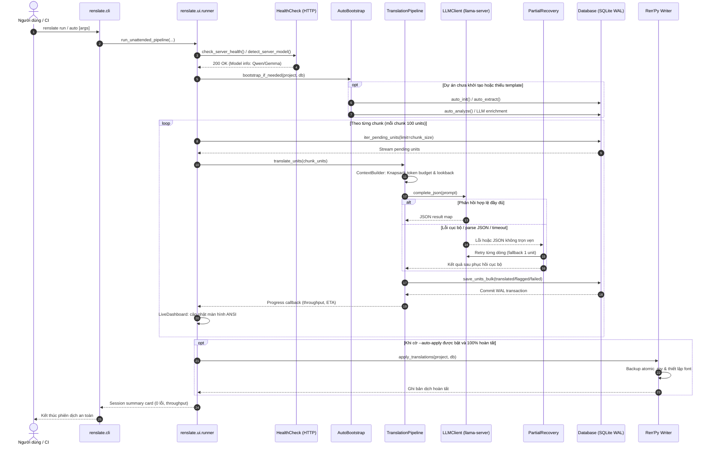
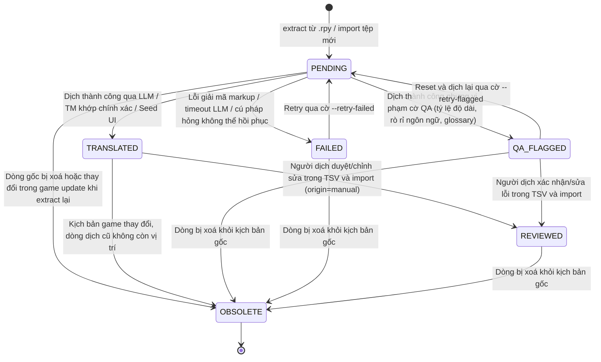

# renslate — Tài liệu thiết kế

Bộ công cụ tự động hoá dịch game Ren'Py sang tiếng Việt bằng model local **Gemma 4 26B MoE (IQ4)**, bao phủ toàn bộ UI lẫn lời thoại, có lưu trữ trạng thái và tối ưu ngữ cảnh để giữ chất lượng dịch ổn định xuyên suốt game.

- **Trạng thái:** Proposed
- **Ngôn ngữ / phụ thuộc:** Python ≥ 3.10, chỉ dùng thư viện chuẩn (zero-dependency)
- **Backend LLM:** server tương thích OpenAI (`/v1/chat/completions`) chạy local: llama.cpp `llama-server`, LM Studio, Ollama, KoboldCpp...

---

## 1. Mục tiêu và ràng buộc

### 1.1 Yêu cầu chức năng
| # | Yêu cầu |
|---|---------|
| F1 | Trích xuất mọi chuỗi cần dịch: lời thoại, lựa chọn menu, chuỗi UI (`_()`, screen text), chuỗi built-in của Ren'Py (Quit, Save, Load, Preferences, xác nhận...) |
| F2 | Dịch hàng loạt qua model local, resume được sau khi dừng/lỗi |
| F3 | Nhất quán: tên nhân vật, thuật ngữ, xưng hô, giọng văn theo từng nhân vật |
| F4 | Không phá script: giữ nguyên tag `{i}`, `{color=}`, biến `[name]`, escape `\"`, `\n`, `%%` |
| F5 | Xuất file đúng chuẩn hệ thống dịch gốc của Ren'Py (`game/tl/vietnamese/*.rpy`) để game chạy được mà không sửa file gốc |
| F6 | Cho phép người dịch review/sửa tay (TSV) rồi nhập lại, sửa tay luôn được ưu tiên |
| F7 | Xử lý font: đảm bảo hiển thị dấu tiếng Việt, thêm lựa chọn ngôn ngữ trong game |

### 1.2 Ràng buộc phi chức năng
- **Context window hạn chế** của model local (giả định 8k–16k token hữu dụng) → phải chọn lọc ngữ cảnh.
- **Tốc độ thấp** (MoE IQ4 trên GPU/CPU cá nhân) → giảm số lần gọi, tái sử dụng bản dịch, chạy được qua đêm, resume.
- **Không làm hỏng game**: mọi thao tác ghi đều backup trước; không đụng vào `.rpy` gốc.
- **Cài đặt đơn giản**: không `pip install`; một thư mục, chạy bằng `python -m renslate`.

---

## 2. Quyết định kiến trúc chính (ADR rút gọn)

### ADR-1: Dùng hệ thống `translate` gốc của Ren'Py, không ghi đè script
- **Context:** Có thể sửa trực tiếp `.rpy` hoặc dùng cơ chế `tl/<ngôn_ngữ>/`.
- **Decision:** Sinh file trong `game/tl/vietnamese/` theo cấu trúc của lệnh `renpy.sh <game> translate vietnamese`.
- **Lý do:** Không phá bản gốc, cập nhật game dễ (chạy lại để lấy chuỗi mới), chuyển ngôn ngữ trong game, định danh dòng thoại ổn định theo hash của Ren'Py.
- **Hệ quả:** Phải parse đúng định dạng file `tl` (khối `translate <lang> <id>:` cho thoại, `translate <lang> strings:` cho chuỗi). Người dùng cần chạy lệnh `translate` của Ren'Py một lần để sinh khung (tool hỗ trợ cả chế độ tự trích xuất khi không có Ren'Py SDK).

### ADR-2: SQLite làm kho trạng thái duy nhất
- **Options:** (A) JSON/TSV phẳng, (B) SQLite.
- **Decision:** SQLite (`project.db`) cho đơn vị dịch, translation memory, glossary, hồ sơ nhân vật, tóm tắt cảnh, nhật ký batch.
- **Lý do:** Truy vấn theo trạng thái/cảnh/nhân vật, ghi nguyên tử (an toàn khi bị ngắt giữa chừng), nằm trong thư viện chuẩn. TSV vẫn dùng cho **trao đổi** với người review.

### ADR-3: Che (mask) mọi token không dịch bằng placeholder
- **Decision:** Trước khi gửi model, thay escape, biến nội suy, tag định dạng bằng placeholder ổn định (`⟦V1⟧`, `⟦T1⟧`, `⟦E1⟧`...); sau dịch, kiểm tra đủ/đúng thứ tự rồi khôi phục.
- **Lý do:** Model local hay làm hỏng `[name]`, `{i}`, dấu `"`. Che trước + validate sau rẻ hơn nhiều so với tin vào prompt.
- **Hệ quả:** Cần bộ cặp tag mở/đóng (`{i}…{/i}`) và quy tắc cho tag chứa tham số (`{color=#f00}`).

### ADR-4: Dịch theo batch cảnh có ngữ cảnh, đầu ra JSON có cấu trúc
- **Decision:** Gom dòng thoại liên tiếp trong cùng label/cảnh thành batch (ngân sách token cố định), kèm ngữ cảnh; yêu cầu model trả JSON `{id: bản_dịch}`.
- **Lý do:** Tăng nhất quán xưng hô/giọng văn, giảm số lần gọi. JSON giúp ghép kết quả không nhầm dòng; lỗi một dòng thì chỉ retry dòng đó.

### ADR-5: Ưu tiên nguồn bản dịch theo bậc
`sửa tay (manual)` > `translation memory khớp chính xác` > `built-in seed` > `LLM`. Bản dịch người sửa không bao giờ bị ghi đè khi chạy lại.

### ADR-6: Giao tiếp LLM qua HTTP OpenAI-compatible, dùng `urllib`
Không phụ thuộc SDK; đổi backend chỉ cần đổi `base_url`/`model` trong config. Có retry với backoff, timeout dài (model local chậm), temperature thấp.

---

## 3. Kiến trúc tổng thể

```
 game/*.rpy ─┐                            ┌─> game/tl/vietnamese/*.rpy
 game/tl/*  ─┼─> [1 extract] ─> project.db ─> [6 apply] ─┤
 (tuỳ chọn)  ┘        │            ▲  │                  └─> fonts + language option
                      ▼            │  │
              [2 analyze] ─> hồ sơ nhân vật, glossary, tóm tắt cảnh
                                   │
                          [3 translate] <── TM reuse, built-in seed
                              │   ▲
                              ▼   │  prompt = glossary ∩ batch + profile + summary + lookback
                           LLM client (local server)
                              │
                          [4 qa] ──> cờ lỗi ──> [5 review TSV export/import]
```

### 3.1 Cấu trúc module (Kiến trúc phân tầng DAG Subpackages)

Renslate được tổ chức thành 4 domain subpackage chuyên biệt với tính gắn kết cao (high cohesion) và phân tách ranh giới rõ ràng, tuân thủ nguyên tắc Directed Acyclic Graph (DAG) không phụ thuộc vòng:

```
┌──────────────────────────────────────────────┐
│                 renslate.cli                  │
└──────────────────────┬───────────────────────┘
                       │
       ┌───────────────▼──────────────┐
       │          renslate.ui          │
       └───────┬──────────────┬───────┘
               │              │
       ┌───────▼────────┐     │
       │ renslate.engine │     │
       └───┬────────────┤     │
           │            │     │
           │     ┌──────▼─────▼──────┐
           │     │   renslate.renpy   │
           │     └──────┬────────────┘
           │            │
       ┌───▼────────────▼────────────┐
       │        renslate.core         │
       └─────────────────────────────┘
```

Chi tiết các tầng module trong `src/renslate/`:

```
src/renslate/
├── __init__.py               # Re-export toàn bộ symbol công khai trong __all__, ánh xạ sys.modules tương thích ngược
├── __main__.py               # Entrypoint gọi trực tiếp renslate.cli.main()
├── cli.py                    # Bộ phân tích CLI với các lệnh init, extract, analyze, translate, run, auto, wizard...
├── core/                     # Tầng nền tảng (Domain Primitives & Storage) - Không phụ thuộc package nội bộ nào
│   ├── __init__.py           # Re-export các symbol cốt lõi
│   ├── config.py             # Nạp/kiểm tra config.json, ràng buộc kiểu dữ liệu
│   ├── db.py                 # SQLite WAL store, 32 câu lệnh SQL prepared, iterator zero-copy iter_units
│   ├── errors.py             # Hệ thống ngoại lệ domain kế thừa RenslateError
│   ├── models.py             # Các dataclass bất biến (Unit, Status, Origin, UnitKind, GlossaryEntry...)
│   ├── project.py            # Quản lý đường dẫn dự án, cấu trúc thư mục, sao lưu filesystem
│   └── textio.py             # Thao tác đọc ghi tệp nguyên tử (write_atomic), chuẩn UTF-8
├── renpy/                    # Tầng xử lý Ren'Py (AST Parsing & Code Generation) - Chỉ phụ thuộc core
│   ├── __init__.py           # Re-export các symbol Ren'Py
│   ├── builtin_ui.py         # Seed dịch giao diện chuẩn của engine Ren'Py
│   ├── extract.py            # Trích xuất đơn vị dịch từ kịch bản và khung translate
│   ├── literals.py           # Bộ mã hóa/giải mã chuỗi say và Python string literal
│   ├── mask.py               # FSM lexer zero-allocation che/khôi phục markup và validator O(N)
│   ├── parser.py             # Bộ phân tích từ vựng và cú pháp AST khối .rpy
│   ├── sdk.py                # Tích hợp Ren'Py SDK để sinh khung bản dịch
│   └── writer.py             # Ghi đè bản dịch nguyên tử vào .rpy, cấu hình font tiếng Việt
├── engine/                   # Tầng điều phối dịch & NLP (Translation & Quality) - Phụ thuộc renpy và core
│   ├── __init__.py           # Re-export các symbol engine
│   ├── analyze.py            # Phân tích nhân vật, phân đoạn cảnh, khai thác glossary
│   ├── context.py            # Knapsack token budgeting đàn hồi, thu gọn lookback history
│   ├── glossary.py           # Công cụ so khớp thuật ngữ O(1) amortized, trích xuất thực thể
│   ├── llm.py                # HTTP client tương thích OpenAI cho llama-server local, retry có backoff
│   ├── qa.py                 # Bộ quy tắc kiểm tra chất lượng dịch (ngữ pháp, độ dài, rò rỉ ngôn ngữ)
│   ├── tm.py                 # Translation Memory với chỉ mục đảo 3-gram và cắt tỉa ngưỡng toán học
│   ├── translate.py          # Pipeline điều phối dịch batch với cơ chế phục hồi lỗi từng dòng (partial recovery)
│   └── tsvio.py              # Xuất/nhập TSV hỗ trợ UTF-8 BOM cho người dịch hiệu đính
└── ui/                       # Tầng giao diện người dùng (Terminal UI & Runner) - Phụ thuộc engine, renpy, core
    ├── __init__.py           # Re-export widget UI và runner
    ├── dashboard.py          # LiveDashboard: Bảng điều khiển đa panel ANSI/VT100 thời gian thực
    ├── progress.py           # Thanh tiến độ Unicode khối phân số sub-character (1/8 ký tự)
    ├── runner.py             # Pipeline tự động ngầm (autonomous runner), kiểm tra sức khỏe server, xử lý SIGINT 2 giai đoạn
    ├── tables.py             # Bảng Unicode box-drawing thuần thư viện chuẩn, căn chỉnh cột và rút gọn
    ├── theme.py              # Định nghĩa mã màu ANSI, kiểm tra hỗ trợ TTY / NO_COLOR, đo độ rộng ký tự Unicode
    └── wizard.py             # Thuật sĩ tương tác từng bước hướng dẫn thiết lập dự án

scripts/
└── unattended_runner.py      # Lớp vỏ bọc mỏng (thin delegation wrapper) gọi renslate run, giữ tương thích hàm cũ
```

**Cơ chế tương thích ngược (Backward Compatibility Shims):**
- 21 tệp shim tương thích ngược đặt trực tiếp tại `src/renslate/*.py` (`models.py`, `db.py`, `mask.py`, `translate.py`...). Mỗi shim re-export toàn bộ symbol từ subpackage đích, hỗ trợ static typing (`if TYPE_CHECKING:`) cho mypy/IDE, và gắn `sys.modules[__name__]` vào module đích.
- Tệp `src/renslate/__init__.py` cung cấp bảng ánh xạ `_LEGACY_MAP`, tự động đăng ký các module cũ vào `sys.modules`. Điều này đảm bảo các lệnh mock trong kiểm thử (ví dụ `patch("renslate.llm.LLMClient.complete_json")`) hoạt động chính xác 100% mà không bị lệch đối tượng.

### 3.2 Quy trình thực thi của Autonomous Runner (Sequence Diagram)

Quy trình vận hành tự động của `renslate run` / `renslate auto` được mô tả trong biểu đồ tuần tự dưới đây:



---

## 4. Mô hình dữ liệu

### 4.1 Bảng chính (SQLite)

| Bảng | Vai trò | Trường chính |
|------|---------|--------------|
| `units` | Mỗi đơn vị dịch | `uid`, `kind` (`dialogue`/`string`/`ui`), `file`, `line`, `label`, `scene_id`, `seq`, `speaker`, `source`, `masked_source`, `target`, `status`, `origin` (`llm`/`tm`/`manual`/`seed`), `qa_flags`, `updated_at` |
| `tm` | Translation memory | `src_norm`, `target`, `uses`, `origin` |
| `glossary` | Thuật ngữ cố định | `term`, `translation`, `kind` (tên riêng/địa danh/vật phẩm/kỹ năng), `case_sensitive`, `notes` |
| `characters` | Hồ sơ nhân vật | `tag`, `display_name`, `gender`, `role`, `speech_style`, `pronoun_map` (cách xưng hô với từng người) |
| `scenes` | Tóm tắt cảnh | `scene_id`, `label`, `first_seq`, `last_seq`, `summary` |
| `batches` | Nhật ký | `batch_id`, `unit_uids`, `tokens_in/out`, `attempts`, `error` |

### 4.2 Định danh ổn định
- **Thoại:** dùng chính id của Ren'Py (`label_hash`) trong khối `translate vietnamese <id>:`; nếu tự trích xuất từ `.rpy`, sinh id theo cùng quy tắc (label + hash nội dung) để đồng bộ khi chạy lại.
- **Chuỗi (`strings`):** khoá bằng văn bản gốc đã chuẩn hoá, trùng nhau gộp một `uid` (dịch một lần, dùng nhiều nơi).
- Chạy lại `extract` là **idempotent**: unit mới được thêm, unit cũ giữ nguyên bản dịch, unit biến mất bị đánh dấu `obsolete` (không xoá).

### 4.3 Trạng thái unit và Vòng đời bản dịch (State Diagram)

Các đơn vị dịch (`Unit`) chuyển đổi trạng thái qua các giai đoạn trong vòng đời dịch thuật:
- `PENDING`: Đơn vị mới trích xuất từ kịch bản Ren'Py hoặc mới nhập, đang chờ xử lý.
- `TRANSLATED`: Đã dịch thành công qua LLM, hoặc tái sử dụng từ Translation Memory (TM), hoặc nạp từ seed built-in UI.
- `QA_FLAGGED`: Đã dịch nhưng bị gắn cờ cảnh báo chất lượng (tỷ lệ độ dài bất thường, rò rỉ ngôn ngữ nguồn, vi phạm glossary).
- `FAILED`: Dịch thất bại do lỗi không thể khắc phục (mô hình trả JSON hỏng, timeout lặp lại, lỗi khôi phục markup).
- `REVIEWED`: Đơn vị đã được con người kiểm tra, chỉnh sửa và nhập lại qua TSV (`origin=manual`).
- `OBSOLETE`: Đơn vị không còn tồn tại trong kịch bản game gốc sau khi chạy lại `extract`.

Biểu đồ trạng thái Mermaid của đơn vị dịch:



---

## 5. Pipeline chi tiết

### 5.1 `extract` — trích xuất
1. Đọc `game/tl/<lang>/*.rpy` nếu đã có (khung do Ren'Py sinh) hoặc quét `game/**/*.rpy`.
2. Tách khối: `translate <lang> <id>:` (thoại), `translate <lang> strings:` (cặp `old`/`new`), `python early`/`python` giữ nguyên.
3. Với thoại: nhận dạng câu lệnh say (`speaker "text"`, hoặc chỉ `"text"` cho narrator); **loại trừ** lệnh không phải say (`show`, `play`, `$`, `scene`, `with`, `define`...).
4. Với `menu:` lấy các lựa chọn; với `screen`/`_()`/`text "..."` lấy chuỗi UI.
5. Ghi cảnh `scene_id` (theo label + ngắt cảnh `scene`/`jump`), `seq` toàn cục để giữ thứ tự cốt truyện.
6. Nạp seed UI built-in (Start, Load, Save, Preferences, Quit, "Are you sure?"...) cho chuỗi thuộc Ren'Py mà game không override.

### 5.2 `analyze` — chuẩn bị ngữ cảnh (chạy một lần, có thể chạy lại)
- **Hồ sơ nhân vật:** thống kê từ `define e = Character("Eileen")`; model đọc mẫu thoại để đề xuất giới tính, vai vế, giọng văn; người dùng chỉnh tay trong `characters.json`.
- **Khai thác thuật ngữ:** đếm n-gram/từ viết hoa lặp lại, đề xuất ứng viên glossary; người dùng duyệt và thêm bản dịch.
- **Tóm tắt cảnh:** mỗi cảnh một tóm tắt 2–3 câu (model sinh, lưu lại) để làm ngữ cảnh dài hạn rẻ.
- Bảng **xưng hô** (`pronoun_map`) quyết định cặp tôi/cậu, anh/em, ta/ngươi... cho từng cặp nhân vật — nguồn gây mất nhất quán lớn nhất trong dịch Việt.

### 5.3 `translate` — dịch
1. Lấy unit `pending`, theo `seq`.
2. **Reuse:** khớp chính xác trong TM/seed thì điền luôn, không gọi model. Fuzzy ≥ ngưỡng chỉ dùng làm **gợi ý** trong prompt, không tự điền.
3. **Chia batch** theo cảnh với ngân sách token (ví dụ ≤ 1500 token nguồn/batch, ≤ 40 dòng).
4. **Dựng prompt** (xem 6).
5. Gọi LLM, parse JSON, unmask + validate placeholder; dòng lỗi cho vào hàng retry (tối đa N lần, lần sau giảm batch về 1 dòng).
6. Lưu từng batch ngay vào DB (resume an toàn); cập nhật TM.
7. Chạy song song theo `workers` (mặc định 1, vì server local thường tuần tự).

### 5.4 `qa` — kiểm tra
| Kiểm tra | Mức |
|----------|-----|
| Placeholder thiếu/thừa/sai thứ tự; tag không cân | **error** (tự retry) |
| Rỗng, trùng nguyên văn bản gốc (trừ tên riêng) | error |
| Rò rỉ ngôn ngữ (còn nhiều ký tự Latin tiếng Anh / Nhật / Hàn / Trung) | warn |
| Vi phạm glossary (thuật ngữ nguồn có, bản dịch không có dạng chuẩn) | warn |
| Độ dài quá lệch (> k lần nguồn) — nguy cơ tràn textbox | warn |
| Model lặp lại nhãn người nói (`Eileen:`) hoặc thêm giải thích | auto-clean |
| Ngoặc `[` `]` `{` `}` lẻ có thể gây lỗi nội suy khi chạy | error |
| Ký tự không có trong font | warn (xem 7.2) |

### 5.5 `export` / `import` — review
- `export` ra TSV: `uid, file, line, speaker, source, target, flags`; mở được bằng Excel/Sheets.
- `import` chỉ nhận dòng đã đổi, đánh `origin=manual`, chạy lại mask/validate, **đồng bộ số thứ tự placeholder** giữa nguồn và bản sửa. Bản sửa tay cũng đưa vào TM.

### 5.6 `apply` — ghi ra game
1. Backup `game/tl/vietnamese/` vào `.renslate/backup/<timestamp>/`.
2. Sinh `.rpy` theo từng file nguồn; escape lại chuỗi (`\`, `"`, `\n`), bảo vệ ngoặc lẻ.
3. Thêm file `renslate_setup.rpy`: font hỗ trợ tiếng Việt cho ngôn ngữ `vietnamese`, đặt lựa chọn ngôn ngữ trong menu Preferences.
4. Kiểm tra cú pháp nhanh (cân ngoặc, thụt lề) trước khi hoàn tất.

---

## 6. Tối ưu ngữ cảnh và prompt

### 6.1 Cấu trúc prompt
**System (cố định, được cache bởi server nếu hỗ trợ prefix cache):**
- Vai trò: dịch giả localization game visual novel, đích tiếng Việt.
- Quy tắc cứng: giữ nguyên mọi `⟦...⟧`; không dịch tên trong glossary ngoài bản đã định; không thêm giải thích; giữ độ dài tương đương (textbox có hạn); giữ giọng nhân vật.
- Định dạng đầu ra: duy nhất một object JSON `{"<id>": "<bản dịch>", ...}`.

**User (thay đổi theo batch), theo thứ tự ưu tiên khi cắt bớt:**
1. Dòng cần dịch (`id | người nói | nội dung đã mask`) — **không bao giờ cắt**.
2. Glossary chỉ gồm thuật ngữ **xuất hiện trong batch**.
3. Hồ sơ nhân vật chỉ gồm người nói trong batch + bảng xưng hô liên quan.
4. Tóm tắt cảnh hiện tại.
5. Lookback: 3–6 dòng đã dịch ngay trước batch (nguồn + dịch) để nối mạch.
6. Gợi ý TM fuzzy (nếu có chỗ).

### 6.2 Ngân sách token
`budget_context = n_ctx − system − batch_source − reserve_output`. Ước lượng token bằng heuristic ký tự (cấu hình được hệ số cho tiếng Anh/Việt), các phần 2–6 được thêm theo thứ tự ưu tiên đến khi hết ngân sách.

### 6.3 Khớp glossary
Khớp theo ranh giới từ, không phân biệt hoa thường trừ khi đánh dấu; ưu tiên cụm dài trước cụm ngắn; thuật ngữ trùng nhiều dạng (số ít/nhiều) khai báo trong `aliases`.

### 6.4 Cấu hình sinh (mặc định gợi ý)
`temperature 0.2–0.3`, `top_p 0.9`, `max_tokens` theo batch, JSON mode / grammar nếu server hỗ trợ (llama.cpp có thể ép bằng GBNF/`response_format`), nhằm giảm lỗi parse.

---

## 7. Xử lý đặc thù Ren'Py

### 7.1 Mask token
| Loại | Ví dụ | Xử lý |
|------|-------|-------|
| Nội suy | `[player_name]`, `[health!t]` | placeholder, giữ nguyên, kiểm tra còn đủ |
| Tag định dạng | `{i}…{/i}`, `{color=#f00}…{/color}`, `{w}`, `{p}`, `{nw}` | placeholder theo cặp; tag không cặp (`{w}`) giữ vị trí tương đối |
| Escape | `\"`, `\n`, `\\`, `%%` | tách trước khi gửi, khôi phục khi ghi |
| Chuỗi thật sự là mã | giá trị gán biến, đường dẫn file | phân loại *literal vs. text*, không đưa vào dịch |

### 7.2 Font
- Phát hiện font hiện tại của game qua `gui.rpy`/`config`; kiểm tra bao phủ ký tự tiếng Việt (nếu có thư viện đọc cmap thì dùng, không thì đối chiếu bộ ký tự mẫu bằng cách thử render ở bước kiểm tra thủ công).
- Nếu thiếu: tool đề xuất/cấu hình font thay thế (ví dụ Noto Sans, Be Vietnam Pro) trong `translate vietnamese python:` để chỉ ngôn ngữ Việt dùng font này.

### 7.3 Chuỗi UI
Chuỗi trong `screens.rpy` đã bọc `_()` được trích qua khối `strings`. Chuỗi UI ngắn dịch ở chế độ riêng (batch theo `kind=ui`, prompt nhấn mạnh độ ngắn gọn, thuật ngữ nhất quán: Save → Lưu, Load → Tải, v.v. từ seed).

### 7.4 Chọn ngôn ngữ
`apply` thêm mã đặt `define config.default_language` (tuỳ chọn) và mục chuyển ngôn ngữ trong Preferences, qua `Language("vietnamese")` action.

---

## 8. Cấu hình (`config.json`)

```json
{
  "project_dir": "path/to/game_root",
  "target_lang": "vietnamese",
  "llm": {
    "base_url": "http://127.0.0.1:8080/v1",
    "model": "gemma-4-26b-moe-iq4",
    "n_ctx": 12288,
    "temperature": 0.25,
    "timeout_s": 600,
    "max_retries": 3
  },
  "batch": { "max_lines": 40, "max_source_tokens": 1500, "lookback": 4, "workers": 1 },
  "tm": { "fuzzy_threshold": 0.88 },
  "qa": { "max_length_ratio": 1.8 },
  "style": { "default_register": "tự nhiên, trung tính", "notes": "" }
}
```

File người dùng chỉnh tay: `glossary.json`, `characters.json`, `style.md` (hướng dẫn giọng văn riêng của game, được chèn vào system prompt).

---

## 9. Kiểm thử

- **Mock LLM server** (`tests/mock_llm.py`): trả JSON giả theo id, có chế độ cố ý làm hỏng placeholder/JSON để test retry và QA.
- Test đơn vị: parser (thoại, menu, strings, ca đặc biệt), mask/unmask round-trip, escape, glossary matching, TM fuzzy, budgeting.
- Test tích hợp: dự án Ren'Py mẫu nhỏ → extract → translate (mock) → apply → so khớp file `tl` sinh ra; chạy lại để kiểm tra idempotent và bảo toàn `manual`.

---

## 10. Rủi ro và giảm thiểu

| Rủi ro | Giảm thiểu |
|--------|-----------|
| Model local làm hỏng tag/biến | Mask + validate + retry giảm batch; fallback giữ nguyên nguồn và gắn cờ |
| Xưng hô không nhất quán | Bảng `pronoun_map`, hồ sơ nhân vật, lookback, `manual` luôn khoá |
| Context tràn | Ngân sách token + thứ tự ưu tiên cắt |
| Tốc độ chậm | TM/seed, resume, batch theo cảnh, chạy qua đêm |
| Parser bỏ sót cú pháp Ren'Py lạ | Ưu tiên đọc file `tl` do Ren'Py sinh; báo cáo dòng không nhận diện được |
| Mất dữ liệu | SQLite ghi theo batch, backup trước `apply`, không đụng `.rpy` gốc |
| Văn bản dài làm tràn textbox | Cờ `max_length_ratio`, chỉ dẫn "ngắn gọn" trong prompt |

---

## 11. Lộ trình triển khai

1. **M1:** `db`, `parser`, `mask`, `writer` — round-trip không mất chuỗi (extract → apply bản sao nguồn).
2. **M2:** `llm`, `context`, `translate`, mock server — dịch được một cảnh end-to-end.
3. **M3:** `glossary`, `tm`, `analyze`, `qa` — chất lượng và nhất quán.
4. **M4:** `tsvio`, font/ngôn ngữ trong `apply`, built-in UI seed — gói hoàn chỉnh cho người dùng cuối.
5. **M5 (tuỳ chọn):** dịch đa pass (pass 2 hiệu đính bằng cả cảnh), glossary tự học, giao diện web đơn giản.

## 12. Câu hỏi mở
- Server cụ thể nào sẽ dùng (llama.cpp / LM Studio / Ollama) để chốt cách ép JSON?
- Có Ren'Py SDK trên máy để sinh khung `tl` không, hay cần chế độ tự trích xuất hoàn toàn?
- Game mục tiêu đầu tiên và font hiện dùng?

---

## Phụ lục A — Quyết định triển khai giai đoạn M1

Giai đoạn M1 hiện thực hoá phần "đọc – lưu – ghi" của pipeline: `generate`, `extract`, `apply`, `status`. Các điểm dưới đây cụ thể hoá hoặc điều chỉnh các mục tương ứng ở trên.

### A.1 Nguồn đầu vào và đầu ra
- Đầu vào duy nhất là các tệp `game/tl/<ngôn_ngữ>/**/*.rpy` do Ren'Py sinh bằng `renpy translate <ngôn_ngữ> --no-todo`. Lệnh `generate` gọi SDK (`renpy.sh` hoặc `renpy.exe`) để sinh khung; định danh dòng thoại (hash) do chính Ren'Py tạo nên luôn khớp với game. Chế độ tự quét `.rpy` gốc (mục 5.1, bước 1) hoãn lại, vì SDK đã có sẵn.
- `apply` ghi **tại chỗ** vào chính các tệp đó: chỉ thay đúng dòng đích của từng vị trí ghi (dòng lời thoại hoặc dòng `new`), mọi byte khác giữ nguyên, kể cả BOM và kiểu xuống dòng. Chạy `extract` rồi `apply` khi chưa có bản dịch nào không làm thay đổi tệp nào.
- Mỗi vị trí ghi có `fingerprint` gắn dòng neo (dòng `translate …:` hoặc dòng `old`) với dòng đích. Tệp đã bị sửa kể từ lần `extract` gần nhất làm `apply` dừng toàn bộ trước khi ghi bất kỳ tệp nào.
- Trước khi ghi, `apply` kiểm tra markup (`[`/`{` chưa đóng) của mọi bản dịch; một lỗi là dừng toàn bộ. Tệp gốc được sao lưu vào `.renslate/backup/<UTC>/` và được thay bằng ghi nguyên tử.

### A.2 Mô hình dữ liệu (lược đồ v1)
- Bảng `units` (đơn vị dịch) tách khỏi bảng `slots` (vị trí ghi trong tệp), nên một chuỗi UI xuất hiện ở nhiều tệp chỉ dịch một lần (mục 4.2). Các bảng `tm`, `glossary`, `characters`, `scenes`, `batches` sẽ được thêm bằng các migration ở M2–M3.
- `uid` lời thoại: `d:<định_danh_Ren'Py>` (thêm `#n` nếu một khối chứa nhiều câu); `uid` chuỗi: `s:` + 80 bit đầu của SHA-1 văn bản gốc.
- Nguồn gốc bản dịch `origin` có thêm giá trị `imported`: bản dịch đã có sẵn trong tệp khi `extract` lần đầu. `imported` được khoá như `manual` (mục ADR-5): khi văn bản gốc đổi, bản dịch được giữ lại và đơn vị bị gắn cờ `source_changed`; bản dịch máy thì bị xoá và dịch lại.
- Khối `translate` có nhiều câu dịch hơn câu gốc (người dịch tách một câu thành nhiều dòng) vẫn được nhận: câu dịch đầu tiên gắn với câu gốc, các câu dư được giữ nguyên và báo cảnh báo `extra_statements`. Khối trùng định danh chỉ báo cảnh báo `duplicate_id` và dùng khối xuất hiện trước. Khối có ít câu dịch hơn câu gốc là lỗi `block_mismatch`.
- Chỉ lệnh `extract` không có lỗi mới đánh dấu đơn vị biến mất là `obsolete`, tránh mất trạng thái khi một tệp tạm thời hỏng.

### A.3 Che placeholder (mục 7.1)
- Loại placeholder: `V` (nội suy `[x]`, `%(x)s`), `T` (thẻ `{…}`), `E` (`[[`, `{{`, `%%`), `L` (xuống dòng). Thẻ có cặp mở/đóng dùng chung chỉ số: `⟦T1⟧…⟦/T1⟧`.
- Quy tắc kiểm tra: mỗi placeholder xuất hiện đúng một lần, không có placeholder lạ, thẻ mở đứng trước thẻ đóng. **Thứ tự giữa các biến không bị ràng buộc**, vì tiếng Việt có thể đảo trật tự câu.
- `]` và `}` đứng lẻ là hợp lệ trong Ren'Py nên không bị coi là lỗi; chỉ `[` và `{` chưa đóng bị từ chối.

### A.4 Cấu hình (mục 8)
- Cấu hình nằm ở `.renslate/config.json` trong thư mục dự án Ren'Py (bỏ `project_dir`); thêm `tl_dir` (mặc định `game/tl`) và `sdk` (đường dẫn Ren'Py SDK). Khoá không biết bị từ chối để bắt lỗi gõ sai. Các mục `llm`, `batch`, `tm`, `qa`, `style` đã được định nghĩa và kiểm tra sẵn, được dùng từ M2.

### A.5 Giới hạn đã biết của M1
- Chưa hỗ trợ lời thoại dùng nháy đơn, nháy ba hoặc tiền tố `r`: dòng bị bỏ qua và báo cảnh báo `unsupported_syntax`.
- Chưa có `analyze`, `translate`, `qa`, `export`/`import`; xem lộ trình ở mục 11.
